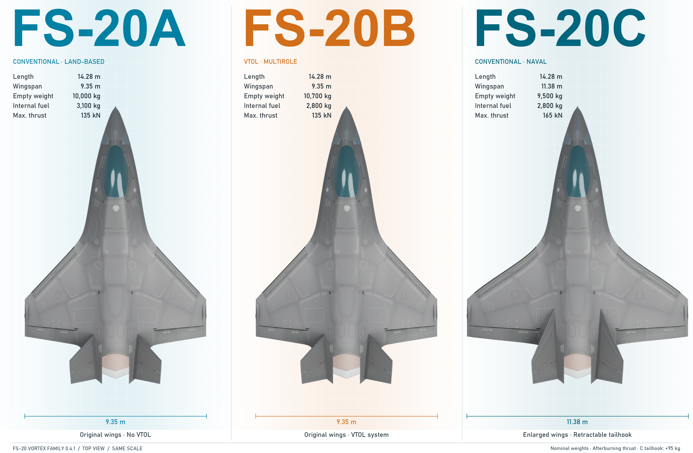
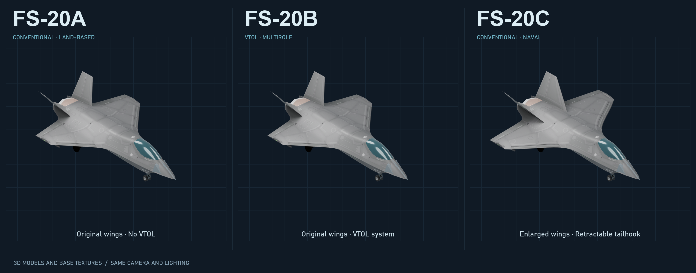

# FS-20-Vortex-Family 0.4.1

Single-player FS-20A and FS-20C variants alongside the stock B, with a native-style selector, C tailhook and optional shared A/B/C stock in one plugin. C: 110/165 kN; A/C: up to +11 G. Online sessions are blocked.

**Experimental single-player prerelease. Multiplayer is intentionally blocked.**
Author: Jpgamer4045d. See AI_ASSISTANCE.md, THIRD_PARTY_NOTICES.md and QA.md.
Not affiliated with or endorsed by Shockfront Studios. Licensed game required.

## Optional Manual Tailhook add-on

[NO Manual Tailhook 0.1.1](addons/manual-tailhook/README.md) provides **Left Ctrl+H**
to deploy/retract an equipped hook and **Left Ctrl+Left Shift+H** to restore
automatic control. HUD messages and configuration descriptions are English.
This is a separate optional download; the Vortex aircraft release stays 0.4.1.
See the add-on page for installation, source and its own validation limits.

## Aircraft comparison

Same-scale model renders with base textures and nominal mod specifications.

## Install

1. Install BepInEx 5 for the game; install Blueprinter 2.1.1 for Vortex Family.
2. Close the game. Remove the old Fs20SharedAirframes.dll before upgrading; its features are now integrated.
3. Extract this mod's BepInEx folder into the Nuclear Option game directory,
   or import its ZIP into NOMM. Do not place a second copy of the same DLL elsewhere.
4. Restart the game yourself. Check BepInEx/LogOutput.log for the mod/version.
5. Remove only BepInEx/plugins/VortexConventional to uninstall. Keep dependencies
   needed by other mods. The optional Install.ps1 script backs up the previous DLL and removes the legacy standalone DLL without launching the game. Saved missions using A/C need Vortex Family to load.

## Shared stock (F1)

With BepInEx Configuration Manager installed, press F1 and open FS-20 Vortex
Family > Inventory > Shared airframe stock. Default: enabled. All three
variants remain selectable in either mode. Enabled: 48 B cells can supply
A/B/C, and taking one leaves 47. Disabled: each variant uses its own native
stock and ownership counts. Switching modes does not duplicate, convert or
redistribute existing cells. The setting is saved in the plugin config.
The old standalone Shared Airframes plugin must not remain installed.

## Build source

Windows, PowerShell 7, .NET Framework 4.7.2 or later, licensed game with BepInEx 5.
Set NUCLEAR_OPTION_PATH or pass -GamePath. restore-compiler.ps1 downloads the
pinned Microsoft compiler from NuGet and verifies its SHA-256; it is not bundled.

    ./build.ps1 -GamePath 'PATH_TO_GAME'

All aircraft and inventory code compiles into one DLL. Outputs are under build/BepInEx/plugins/VortexConventional.
The build uses deterministic compilation. Its dependency hashes are part of
local release evidence; different game/library versions may produce different DLLs.

## Compatibility and support

Target game: 0.34.6. Requires BepInEx 5 and Blueprinter 2.1.1.
This release supports single-player only. The multiplayer menu, remote client
connections, non-Offline hosting and listening transport servers are blocked.
Native local Offline sessions remain permitted. Disable the mod and restart
the game to play online. No host/client compatibility is claimed.

Tests: ./test-offline.ps1 and ./test-stock-option.ps1 -GamePath 'PATH_TO_GAME'.
The second command checks actual configuration and single-player guard prefixes
against local game libraries, without opening sockets or launching the game.
Gameplay features have been tested in-game by the author during development.
Automated checks cover flight/control policies, inventory, saved settings and
single-player guard prefixes. See QA.md for the validation record.
For bug reports include version, minimal mod list, steps, and a redacted log;
do not send account credentials or personal paths. See .github/ISSUE_TEMPLATE.
